# NETWORKWALKS-ALEX-B084H-WK1-PM1-CYBERSECURITY-LAB-SETUP

Documentation for a hands-on cybersecurity lab setup using Oracle VirtualBox and Kali Linux. This project covers the deployment of a virtualized lab environment, network configuration, troubleshooting, verification, shared folder access, and baseline snapshot creation for WK1-PM1.

## 1. Project Overview

This project documents the design, installation, configuration, and verification of a virtual cybersecurity laboratory as part of the NetworkWalks Cybersecurity Internship Programme.

The laboratory was built using Oracle VirtualBox as the hypervisor and Kali Linux as the primary security testing platform. The goal was to create a functional, isolated, and educational lab environment in which cybersecurity tools, networking concepts, and practical security techniques could be explored safely without interfering with the host system.

The project includes the installation of required software, configuration of a VirtualBox NAT Network, manual IP assignment, internet connectivity verification, shared-folder integration, and snapshot creation. It also records the technical issues encountered during setup and the troubleshooting steps used to resolve them.

## 2. Project Objectives

The primary objectives of this project were to:

- Install and configure the required virtualization software.
- Deploy Kali Linux as a virtual machine in Oracle VirtualBox.
- Create a NAT Network named `NatNetwork` using the subnet `10.0.0.0/24`.
- Configure the Kali Linux VM with a static IPv4 address of `10.0.0.2/24`.
- Configure the default gateway and DNS settings.
- Verify internet connectivity from the Kali virtual machine.
- Configure bidirectional shared clipboard and drag-and-drop functionality.
- Establish a shared folder between the Windows host and Kali Linux.
- Create a baseline snapshot of the configured virtual machine.
- Document configuration issues, troubleshooting steps, and solutions.

## 3. Project Scope

### 3.1 Phase 1: Core Laboratory Setup

Phase 1 covers the initial deployment and configuration of the cybersecurity lab and was completed successfully.

Completed Phase 1 tasks included:

- 7-Zip installation.
- Oracle VirtualBox installation.
- NAT Network creation and configuration.
- Kali Linux virtual machine import and registration.
- Static IP configuration.
- Internet connectivity verification.
- Shared folder configuration.
- VM snapshot creation.

### 3.2 Phase 2: Additional Virtual Machines (Optional)

Phase 2 is reserved for future expansion of the lab and remains optional work.

Planned future activities include:

- Installing Windows 11 or Windows 10 as additional virtual machines.
- Installing Windows 7 as an additional virtual machine.
- Installing Android 9x virtual machines.
- Connecting the additional machines to the same virtual network.
- Performing connectivity and service checks between virtual machines.
- Creating snapshots for the additional machines.

Phase 2 was not completed as part of this project and is not presented as finished work.

## 4. Security and Ethical Considerations

This laboratory environment is intended strictly for educational purposes and authorized cybersecurity training.

All security testing and network experiments were conducted within controlled virtual environments. No systems, networks, or devices were tested without appropriate authorization.

## 5. Hardware and Software Specifications

### 5.1 Host Machine Specifications

The cybersecurity lab was deployed on a Lenovo V14 laptop running Windows 11 Pro.

| Component | Specification |
| --- | --- |
| Device | Lenovo V14 |
| Operating System | Windows 11 Pro |
| Processor | Intel Core i7 |
| CPU Cores | 10 |
| Logical Processors | 16 |
| Installed RAM | 16 GB |
| Available Storage | 319 GB (at time of setup) |

### 5.2 Software Requirements

The following software was installed and used during the lab setup.

| Software | Version | Purpose |
| --- | --- | --- |
| 7-Zip | 26.02 | Extracting the Kali Linux virtual machine archive |
| Oracle VirtualBox | 7.2.22 | Virtualization and VM management |
| Kali Linux | 2026.3 | Primary cybersecurity testing environment |
| Windows 11 Pro | Host OS | Operating system running VirtualBox |

### 5.3 Virtual Machine Specifications

| Configuration | Value |
| --- | --- |
| Virtual Machine | Kali Linux 2026.3 |
| Hypervisor | Oracle VirtualBox |
| Network Adapter | Adapter 1 |
| Network Attachment | NAT Network |
| NAT Network Name | NatNetwork |
| Network CIDR | 10.0.0.0/24 |
| Assigned IP Address | 10.0.0.2/24 |
| Default Gateway | 10.0.0.1 |
| Preferred DNS | 8.8.8.8 |
| Alternate DNS | 1.1.1.1 |

## 6. Network Architecture and Configuration

### 6.1 Network Overview

The lab uses Oracle VirtualBox's NAT Network feature to provide network connectivity for the Kali Linux virtual machine.

A dedicated NAT Network named `NatNetwork` was created using the IPv4 subnet `10.0.0.0/24`. The Kali virtual machine was configured with a static IPv4 address of `10.0.0.2/24`, and `10.0.0.1` was configured as the default gateway. DNS servers were set to `8.8.8.8` and `1.1.1.1`.

### 6.2 Network Topology

The following diagram illustrates the lab network architecture.

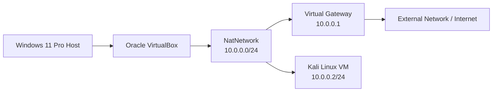

### 6.3 IP Addressing Scheme

| Parameter | Configuration |
| --- | --- |
| Network Name | NatNetwork |
| Network Type | NAT Network |
| IPv4 Network | 10.0.0.0/24 |
| Subnet Mask | 255.255.255.0 |
| Network Address | 10.0.0.0 |
| Default Gateway | 10.0.0.1 |
| Kali Linux IP | 10.0.0.2 |
| DNS Server 1 | 8.8.8.8 |
| DNS Server 2 | 1.1.1.1 |
| DHCP Server | Disabled (observed in command-line output) |

### 6.4 Kali Linux Network Configuration

The Kali VM was configured with a static IPv4 address using NetworkManager and `nmcli`.

The following commands were used:

Step 1: Configure the static IP address, gateway, and DNS servers.

```bash
sudo nmcli connection modify "Wired connection 1" ipv4.method manual ipv4.addresses 10.0.0.2/24 ipv4.gateway 10.0.0.1 ipv4.dns "8.8.8.8 1.1.1.1"
```

Step 2: Deactivate the network connection.

```bash
sudo nmcli connection down "Wired connection 1"
```

Step 3: Reactivate the network connection.

```bash
sudo nmcli connection up "Wired connection 1"
```

Step 4: Verify the assigned IP address.

```bash
ip -4 addr show eth0
```

The expected address was:

```text
10.0.0.2/24
```

### 6.5 DHCP Configuration and Network Validation Notes

During early setup, the VirtualBox NAT Network DHCP service was reported as using `10.0.0.2` as its own address. This conflicted with the static IP address assigned to the Kali virtual machine, making manual configuration necessary.

To resolve the conflict, DHCP was disabled on `NatNetwork`, and the Kali VM was then configured manually with the required static IP address.

This configuration was later validated through connectivity checks:

- Gateway connectivity was verified.
- Internet connectivity was verified.
- DNS resolution was verified.

Important note: There was a configuration discrepancy between the VirtualBox GUI and the command-line evidence. The VirtualBox GUI displayed the DHCP checkbox as enabled, while `VBoxManage list dhcpservers` reported DHCP as disabled. This discrepancy was not concealed or treated as a certainty beyond the available evidence.

## 7. Installation and Deployment Procedure

This section documents the installation and deployment of the software and virtual machine components used in the lab.

### 7.1 Installation of 7-Zip

7-Zip was installed on the Windows host to extract the compressed Kali Linux VM archive.

- Software: 7-Zip
- Version: 26.02
- Official website: https://www.7-zip.org/

The installation was completed successfully.

### 7.2 Installation of Oracle VirtualBox

Oracle VirtualBox was installed as the hypervisor used to create and manage the virtual machines.

- Software: Oracle VM VirtualBox
- Version: 7.2.22
- Official website: https://www.virtualbox.org/

VirtualBox provided the virtualization environment required to run Kali Linux independently of the host operating system.

### 7.3 Creation of the NAT Network

A NAT Network named `NatNetwork` was created through the VirtualBox network configuration interface.

The following settings were applied:

| Setting | Value |
| --- | --- |
| Network Name | NatNetwork |
| Network Type | NAT Network |
| IPv4 Prefix | 10.0.0.0/24 |
| Gateway | 10.0.0.1 |

The network was configured to provide internet connectivity to VM instances connected to it.

### 7.4 Download and Import of Kali Linux

The prebuilt Kali Linux VirtualBox image was downloaded from the official Kali Linux website.

The downloaded archive was:

`kali-linux-2026.3-virtualbox-amd64.7z`

Deployment procedure:

1. The downloaded archive was extracted using 7-Zip.
2. The extracted directory containing the VirtualBox configuration file (`.vbox`) and virtual disk (`.vdi`) was located.
3. The `.vbox` configuration file was added to VirtualBox using the machine registration process.
4. The Kali VM was successfully registered and appeared in VirtualBox Manager.

### 7.5 Initial Import Issue: Duplicate UUID

During the initial deployment, VirtualBox returned a duplicate UUID error.

This occurred because the VM was already registered or had an existing registration that conflicted with the new import attempt.

Resolution:

The existing duplicate VM entry was removed using the `Remove Only` option. This removed the registration without deleting the VM files, and the `.vbox` configuration was then added successfully.

### 7.6 Kali Linux Virtual Machine Configuration

After successful registration, the Kali Linux VM was configured with the following settings:

- Network Adapter 1 attached to `NatNetwork`.
- Static IP configured as `10.0.0.2/24`.
- Gateway set to `10.0.0.1`.
- DNS set to `8.8.8.8` and `1.1.1.1`.
- Shared Clipboard configured as bidirectional.
- Drag and Drop configured as bidirectional.

### 7.7 Shared Folder Configuration

A shared folder was configured to provide access to files stored on the Windows host, specifically the host Downloads directory.

The shared folder was configured through:

`VirtualBox VM Settings -> Shared Folders`

Options used:

- Auto-mount: Enabled.
- Read-only: Disabled.
- Shared folder access: Bidirectional.

The shared directory appeared inside Kali Linux as:

`/media/sf_Downloads`

The contents were successfully accessed from the Kali VM.

### 7.8 Baseline Snapshot Creation

After the initial configuration, the Kali Linux VM was shut down correctly.

A baseline snapshot was created in VirtualBox Manager with the following name:

`WK1-PM1-Base-Setup-Complete`

This snapshot preserved the initial configured state of the VM and provided a restore point for future lab activities.

## 8. Troubleshooting Records

### 8.1 Duplicate VM UUID Error

Problem:

A duplicate VM UUID issue occurred during the import process. This prevented the VM from being re-registered cleanly.

Resolution:

The existing duplicate VM registration was removed using the `Remove Only` option. This preserved the original VM files while removing the conflict and allowing the VM to be added successfully.

### 8.2 Static IP and DHCP Conflict

Problem:

A conflict occurred between the required static IP address for the Kali VM (`10.0.0.2`) and the VirtualBox DHCP configuration for the NAT network.

Resolution:

DHCP was disabled for the `NatNetwork`, and the Kali VM was configured with the required static IP, default gateway, and DNS settings manually.

### 8.3 Network Configuration Process

The network configuration process included:

- Creating the `NatNetwork`.
- Assigning the network prefix `10.0.0.0/24`.
- Setting the gateway to `10.0.0.1`.
- Applying static IP settings to the Kali VM.
- Restarting the interface after changes.
- Validating connectivity to the gateway, internet, and DNS.

### 8.4 Shared Folder Configuration and Access

The shared folder was created and mounted successfully between the Windows host and the Kali VM. This enabled file exchange without requiring the host and guest to be on the same physical filesystem. The VM successfully accessed files stored on the host system via the mounted shared folder.

## 9. Verification Summary

The following configuration was verified:

| Check | Status |
| --- | --- |
| NAT Network Name | `NatNetwork` |
| Network Prefix | `10.0.0.0/24` |
| Kali static IP | `10.0.0.2/24` |
| Gateway | `10.0.0.1` |
| DNS | `8.8.8.8`, `1.1.1.1` |
| Gateway connectivity | Verified |
| Internet connectivity | Verified |
| DNS resolution | Verified |
| DHCP status | Reported as disabled by `VBoxManage list dhcpservers` |
| GUI/DHCP discrepancy | Documented and not resolved beyond the evidence |

## 10. Screenshots and Verification Evidence

The following screenshots document the installation, configuration, and verification process. All images are embedded using relative paths in the repository.

### 10.1 Host System Information

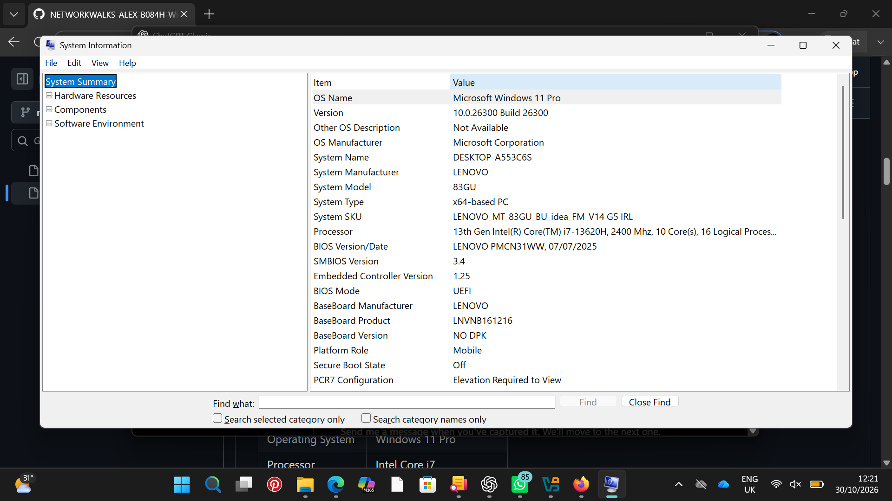

### 10.2 Software Installation

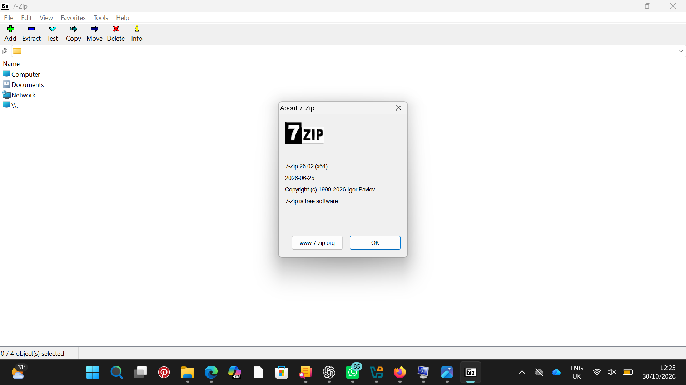

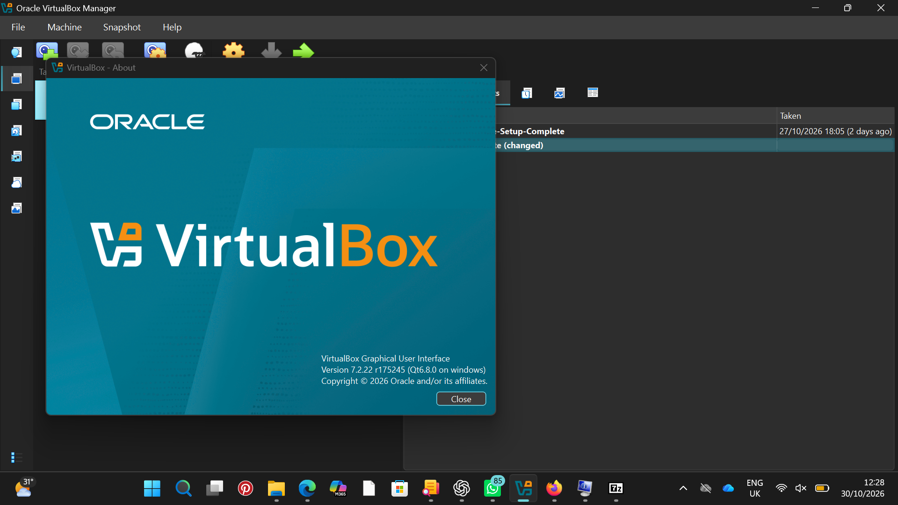

### 10.3 Network Configuration

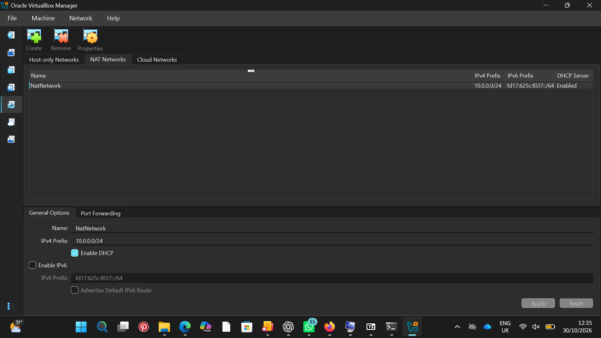

### 10.4 Kali Linux Virtual Machine

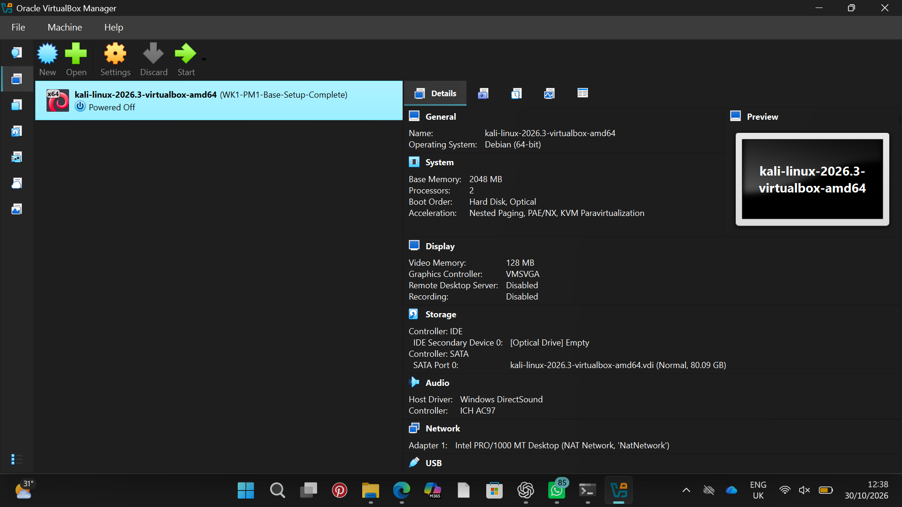

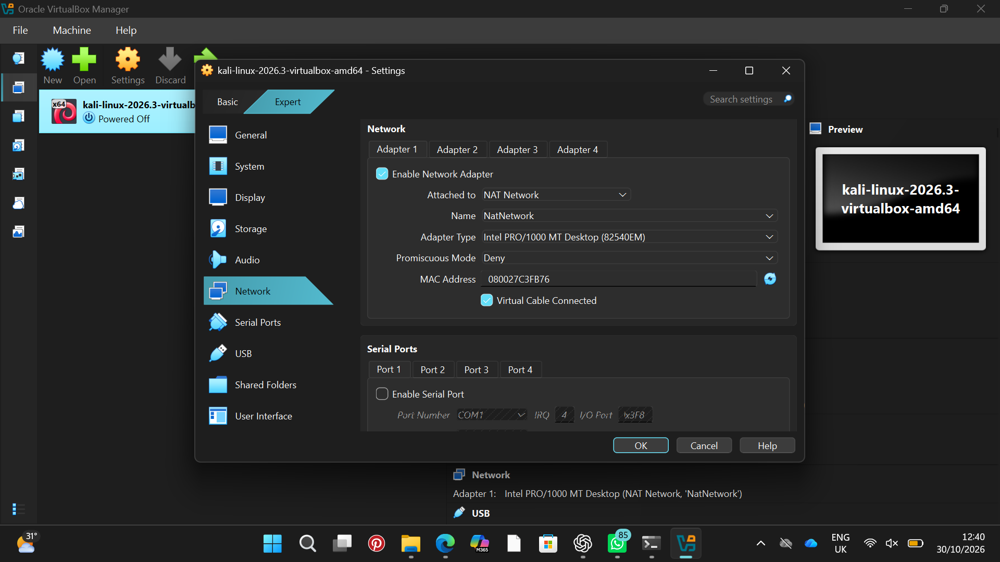

### 10.5 Network Verification

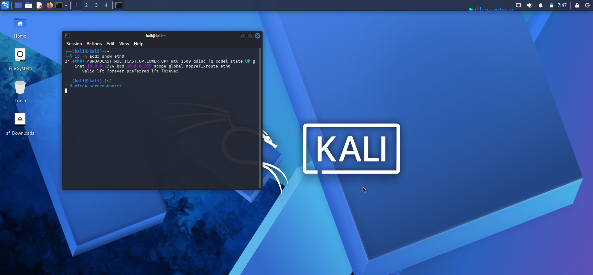

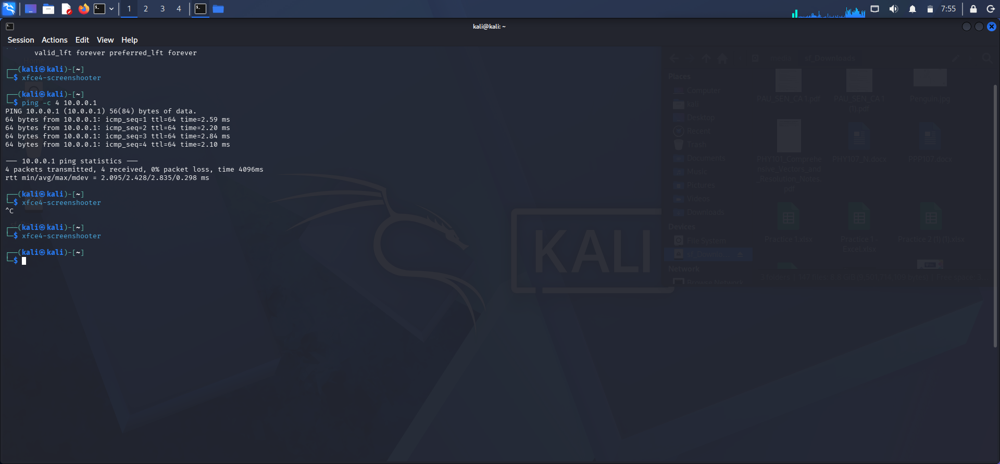

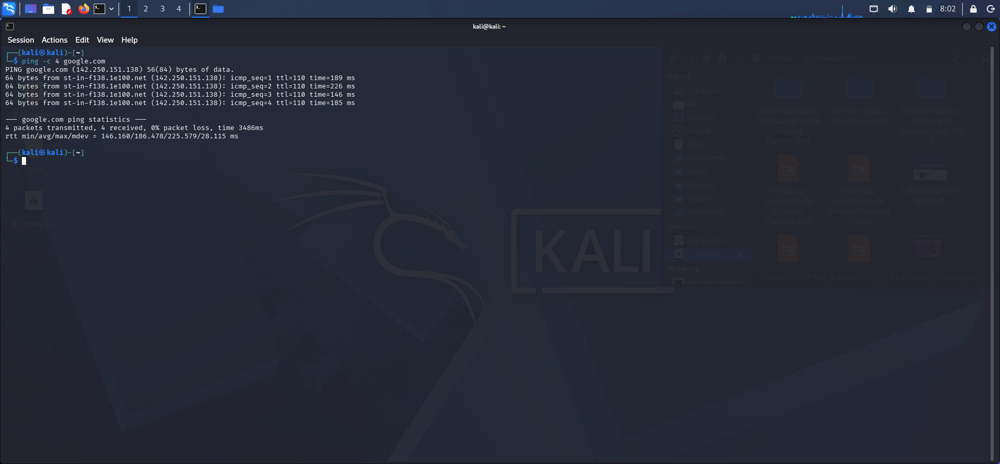

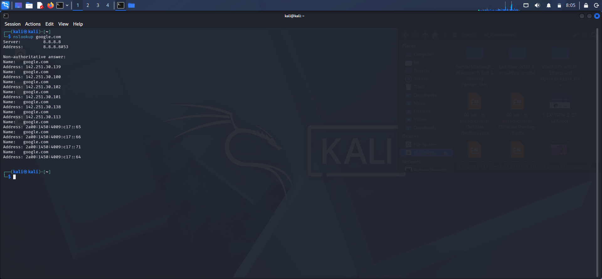

### 10.6 Shared Folder Configuration

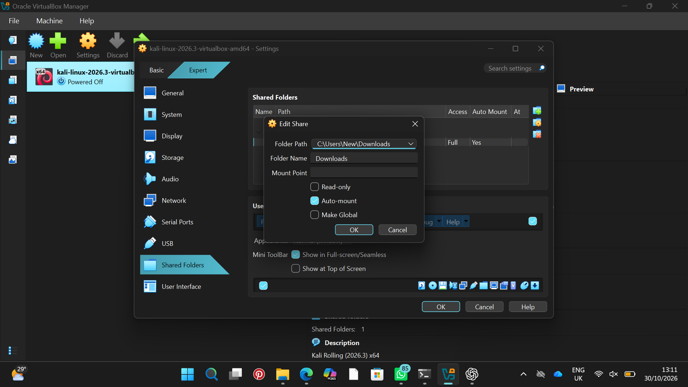

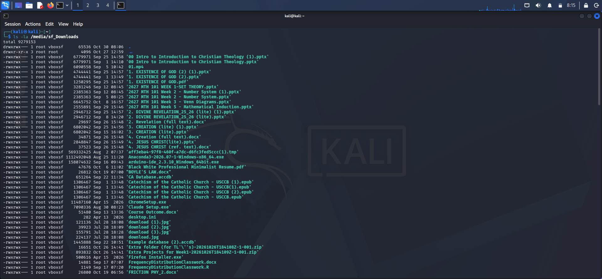

### 10.7 VirtualBox Integration Features

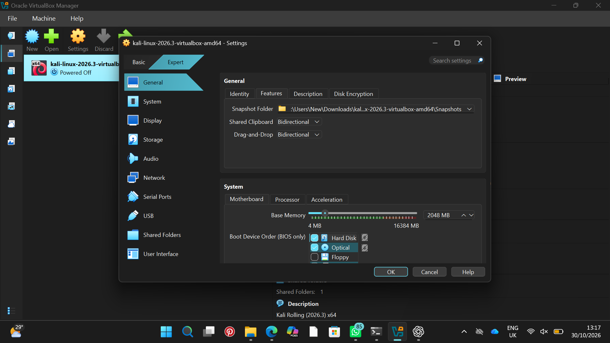

### 10.8 Baseline Snapshot

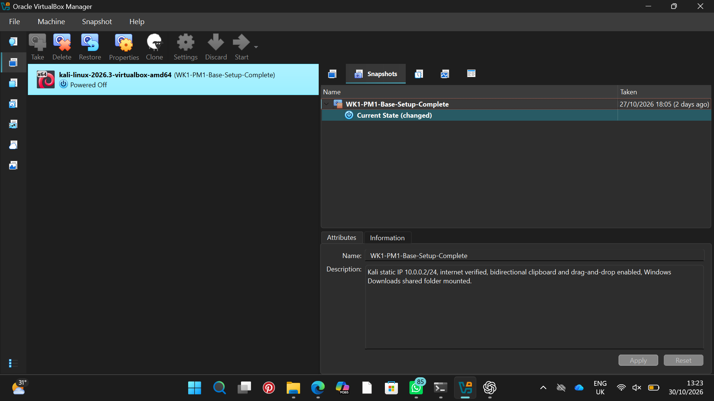

## 11. Conclusion

This project successfully established a working virtual cybersecurity lab environment using Oracle VirtualBox and Kali Linux. The lab was configured with a dedicated NAT network, static addressing, gateway and DNS settings, and shared-folder access for practical learning and operational flexibility.

The environment was verified to the extent supported by the evidence collected during setup: the Kali VM had a valid static IP (`10.0.0.2/24`), connectivity to the gateway (`10.0.0.1`) was confirmed, internet access was working, and DNS resolution succeeded. The configuration was also documented with troubleshooting notes for the duplicate VM UUID issue and the DHCP/static IP conflict.

The lab created in this project provides a stable and reusable baseline for future cybersecurity exercises and additional virtual machine deployment. It demonstrates the practical steps required to build, validate, and document a secure training environment in a controlled and ethically responsible manner.

## 12. Final Notes

This document represents the completed Phase 1 implementation for the WK1-PM1 Virtual Cybersecurity Lab Setup. Phase 2 tasks remain optional future work and were intentionally kept separate from the completed configuration and verification work.
