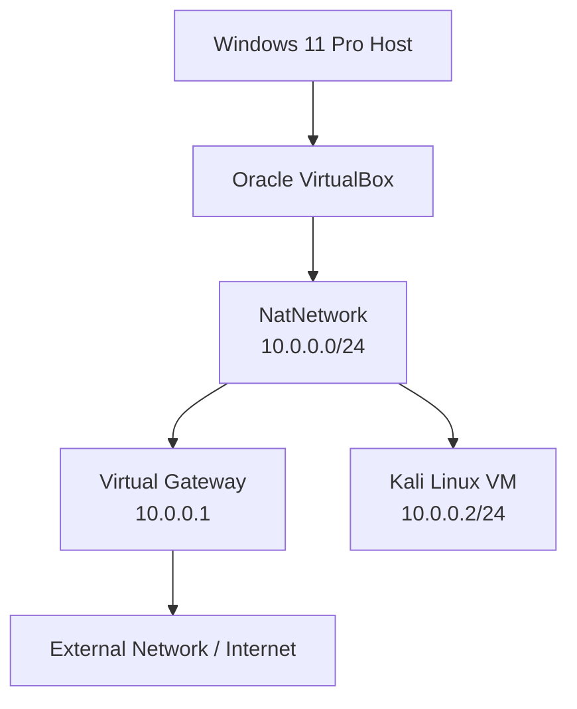

# NETWORKWALKS-ALEX-B084H-WK1-PM1-CYBERSECURITY-LAB-SETUP
Documentation of a hands-on cybersecurity lab setup using Oracle VirtualBox and Kali Linux. Includes network configuration, troubleshooting, connectivity verification, shared folders, snapshots and technical lessons learned.


## 1. Project Overview

This project documents the design, installation, configuration and verification of a virtual cybersecurity laboratory as part of the NetworkWalks Cybersecurity Internship Programme.

The laboratory was built using Oracle VM VirtualBox as the hypervisor and Kali Linux as the primary security testing environment.

The main goal was to create a functional virtual environment where cybersecurity tools, networking concepts and practical security techniques can be explored safely without interfering with the host operating system or external networks.

The project covers the installation of the required software, configuration of a virtual NAT Network, manual IP address assignment, internet connectivity testing, shared folder integration and virtual machine snapshot management.

It also documents the technical challenges encountered during setup, the troubleshooting methods used and the solutions implemented.

## 2. Project Objectives

The primary objectives of this project are to:

* Install and configure the required virtualization software.
* Deploy Kali Linux as a virtual machine using Oracle VirtualBox.
* Create a NAT Network with the subnet `10.0.0.0/24`.
* Configure Kali Linux with a static IPv4 address of `10.0.0.2/24`.
* Configure the default gateway and DNS settings.
* Verify internet connectivity from the Kali virtual machine.
* Configure bidirectional shared clipboard and drag-and-drop functionality.
* Establish a shared folder between the Windows host and Kali Linux.
* Create a baseline snapshot of the configured virtual machine.
* Document configuration errors, troubleshooting procedures and their solutions.

## 3. Project Scope

### 3.1 Phase 1: Core Laboratory Setup

Phase 1 covers the initial deployment and configuration of the cybersecurity laboratory.

The completed setup includes:

* 7-Zip installation.
* Oracle VirtualBox installation.
* NAT Network creation and configuration.
* Kali Linux virtual machine import.
* Static IP configuration.
* Internet connectivity verification.
* Shared folder configuration.
* Virtual machine snapshot creation.

### 3.2 Phase 2: Additional Virtual Machines (Optional)

Phase 2 is reserved for future expansion of the laboratory.

The proposed activities include:

* Installing Windows 11 or Windows 10 as a virtual machine.
* Installing Windows 7 as a virtual machine.
* Installing Android 9x as a virtual machine.
* Connecting the additional machines to the virtual network.
* Performing connectivity tests between all virtual machines.
* Creating snapshots of the additional virtual machines.

Phase 2 is optional future work and is not included in the completed Phase 1 implementation.

## 4. Security and Ethical Considerations

This laboratory is intended strictly for educational purposes and authorized cybersecurity training.

All security testing and network experiments will be conducted within controlled virtual environments.

No systems, networks or devices will be tested without appropriate authorization.

## 5. Hardware and Software Specifications

### 5.1 Host Machine Specifications

The cybersecurity laboratory was deployed on a Lenovo V14 laptop running Windows 11 Pro.

| Component          | Specification             |
| ------------------ | ------------------------- |
| Device             | Lenovo V14                |
| Operating System   | Windows 11 Pro            |
| Processor          | Intel Core i7             |
| CPU Cores          | 10                        |
| Logical Processors | 16                        |
| Installed RAM      | 16 GB                     |
| Available Storage  | 319 GB (at time of setup) |

### 5.2 Software Requirements

The following software was installed and used during the laboratory setup.

| Software          | Version | Purpose                                           |
| ----------------- | ------- | ------------------------------------------------- |
| 7-Zip             | 26.02   | Extracting the Kali Linux virtual machine archive |
| Oracle VirtualBox | 7.2.22  | Virtualization and virtual machine management     |
| Kali Linux        | 2026.3  | Primary cybersecurity testing environment         |
| Windows 11 Pro    | Host OS | Operating system running VirtualBox               |

### 5.3 Virtual Machine Specifications

| Configuration       | Value             |
| ------------------- | ----------------- |
| Virtual Machine     | Kali Linux 2026.3 |
| Hypervisor          | Oracle VirtualBox |
| Network Adapter     | Adapter 1         |
| Network Attachment  | NAT Network       |
| NAT Network Name    | NatNetwork        |
| Network CIDR        | 10.0.0.0/24       |
| Assigned IP Address | 10.0.0.2/24       |
| Default Gateway     | 10.0.0.1          |
| Preferred DNS       | 8.8.8.8           |
| Alternate DNS       | 1.1.1.1           |

**Note:** The NAT Network DHCP server was disabled during configuration because its address (`10.0.0.2`) conflicted with the static IP required for the Kali virtual machine. Kali was subsequently configured manually.

## 6. Network Architecture and Configuration

### 6.1 Network Overview

The laboratory uses Oracle VirtualBox's NAT Network feature to provide network connectivity to the Kali Linux virtual machine.

A dedicated NAT Network named `NatNetwork` was created using the IPv4 subnet `10.0.0.0/24`.

The Kali virtual machine was assigned a static IPv4 address of `10.0.0.2/24`, with `10.0.0.1` configured as its default gateway.

### 6.2 Network Topology

The following diagram illustrates the laboratory's network structure.



### 6.3 IP Addressing Scheme

| Parameter       | Configuration |
| --------------- | ------------- |
| Network Name    | NatNetwork    |
| Network Type    | NAT Network   |
| IPv4 Network    | 10.0.0.0/24   |
| Subnet Mask     | 255.255.255.0 |
| Network Address | 10.0.0.0      |
| Default Gateway | 10.0.0.1      |
| Kali Linux IP   | 10.0.0.2      |
| DNS Server 1    | 8.8.8.8       |
| DNS Server 2    | 1.1.1.1       |
| DHCP Server     | Disabled      |

### 6.4 Kali Linux Network Configuration

The Kali virtual machine was configured with a static IPv4 address using NetworkManager's command-line utility (`nmcli`).

The following commands were executed:

**Step 1: Configure the static IP address, gateway and DNS servers.**

```bash
sudo nmcli connection modify "Wired connection 1" ipv4.method manual ipv4.addresses 10.0.0.2/24 ipv4.gateway 10.0.0.1 ipv4.dns "8.8.8.8 1.1.1.1"
```

**Step 2: Deactivate the network connection.**

```bash
sudo nmcli connection down "Wired connection 1"
```

**Step 3: Reactivate the network connection.**

```bash
sudo nmcli connection up "Wired connection 1"
```

**Step 4: Verify the assigned IP address.**

```bash
ip -4 addr show eth0
```

The expected address is:

```text
10.0.0.2/24
```

### 6.5 DHCP Configuration

During the initial network configuration, the VirtualBox DHCP server was using `10.0.0.2` as its own address.

This conflicted with the static IP address required for the Kali virtual machine.

To resolve the conflict, DHCP was disabled on `NatNetwork`. The Kali virtual machine was then configured manually with the required static IP address.

This configuration was verified through successful network connectivity tests.

